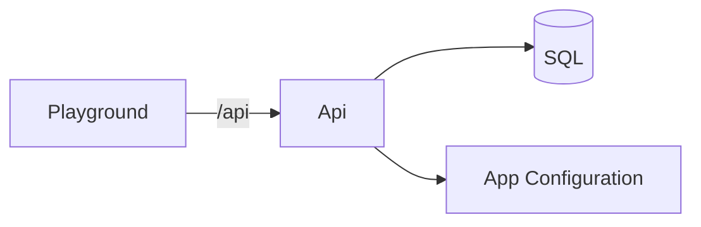

# Todos, a feature flag, and SQL

An Aspire application whose API and playground are TypeScript. The AppHost is C#. It starts the App Configuration emulator, a SQL Server container, and the two Node processes. `server.ts` only builds the app and listens. It does not name a feature or open a database.

`GET /hello` returns Hello World. When the `HelloNewWorld` flag is on, it returns Hello New World. `GET /ping` returns `{ "status": "pong" }`. Todos are created, listed, updated, and deleted in SQL Server. A blank title, or a title longer than 200 characters, is a `400` problem response and does not reach the database.



## What is in the box

- One Fastify app. Tests call `buildApp` and `app.inject`. They do not start Aspire.
- A feature is a folder. `loadFeatures` imports every `configure.ts` and every file named `*Endpoint.ts`. The host has no list of features. Node has no assembly scan, so the convention is the file name.
- Zod checks the body before any SQL. The store runs parameterized statements. The table script is `0001_create_todos.sql`, recorded in `dbo.SchemaMigrations`. Applying it takes a SQL application lock so two replicas cannot run the same script together.
- `npm run dev` runs the API through tsx. The published container runs `npm run build`, then `node dist/server.js`. Relative imports in the API end in `.js` so that output loads under plain Node. The SQL script is copied beside the compiled schema module.
- The flag refreshes about every 5 seconds. No App Configuration connection means the flag is off. A failed refresh keeps the last value.
- The playground is a second process. It proxies `/api/*` to the API address Aspire injects, and the browser stays on one origin.

## A feature owns its endpoint and its setup

`hosting/features.ts` loads every feature. A feature folder adds `configure.ts` when it has services, and one `*Endpoint.ts` per action. `GetHelloEndpoint` reads the flag. `CreateTodoEndpoint` checks the title and calls the store. The todos `configure.ts` opens SQL and applies `0001_create_todos.sql`. Delete the folder and both the routes and the setup are gone.

```typescript
export function endpoint(services: Services) {
  const store = services.get(todoStore);

  return async function register(app: FastifyInstance): Promise<void> {
    app.post("/todos", async (request, reply) => {
      const parsed = createTodo.safeParse(request.body);
      if (!parsed.success) {
        return sendProblem(reply, validationProblem(parsed.error));
      }

      const todo = await store.create(parsed.data.title);
      return reply.code(201).header("location", `/todos/${todo.id}`).send(todo);
    });
  };
}
```

The title rule lives next to the row type in `features/todos/todo.ts`. The store in `todo-store.ts` does not validate. The route does not write SQL.

The SQL connection name is `todos`. Aspire injects an ADO.NET string (`Server=...;User ID=...;Password=...;Database=todos`). `openPool` turns that into the `mssql` config, including `Authentication=Active Directory Default` for a published Azure SQL database. Locally the server is a container and the password is Aspire's.

The App Configuration connection name is `appconfiguration`. An `http://` endpoint is the emulator, read with the key-value HTTP API. An `https://` endpoint uses `@azure/app-configuration` with the connection string, or `DefaultAzureCredential` when the string has no secret. The emulator seeder writes `HelloNewWorld` disabled and `Demo:Sentinel` set to `1`. The flag document is `.appconfig.featureflag/HelloNewWorld`.

## Run

```bash
dotnet run --project src/AppHost
```

Docker must be running. The first start pulls the App Configuration emulator and SQL Server. The playground listens on `http://localhost:5190`. The dashboard lists the same address on the **web** resource.

```bash
npm test
```

Todo tests start one SQL Server Testcontainer and call the real routes. Loading the app runs every feature setup, so hello and ping tests use that same database. Nothing in the test project starts the AppHost.

## Projects

| Path | Owns |
| --- | --- |
| `src/AppHost` | Aspire. Emulator, SQL, and the two Node apps. C#. |
| `src/api` | Fastify. Hello, ping, todos, SQL, feature flags. |
| `src/web` | The playground and the `/api` proxy. |
